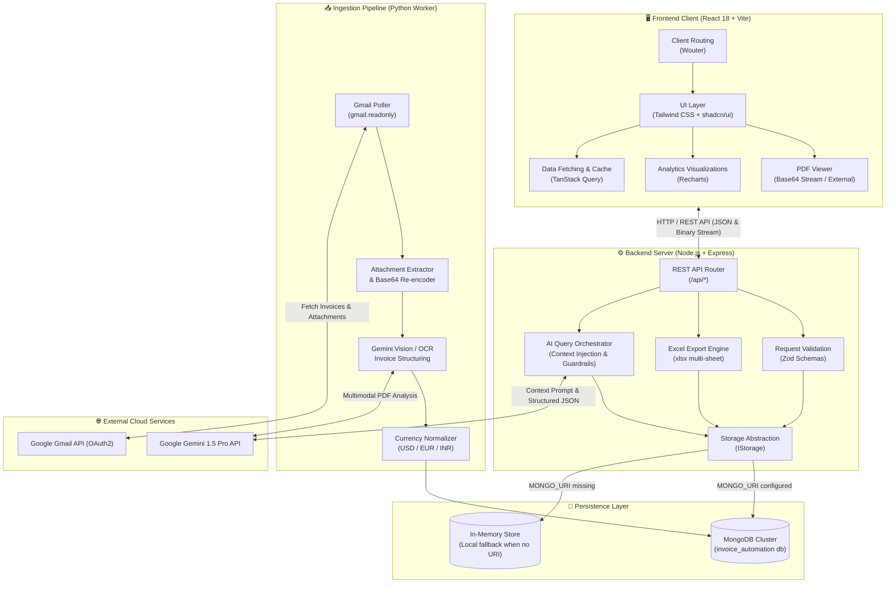
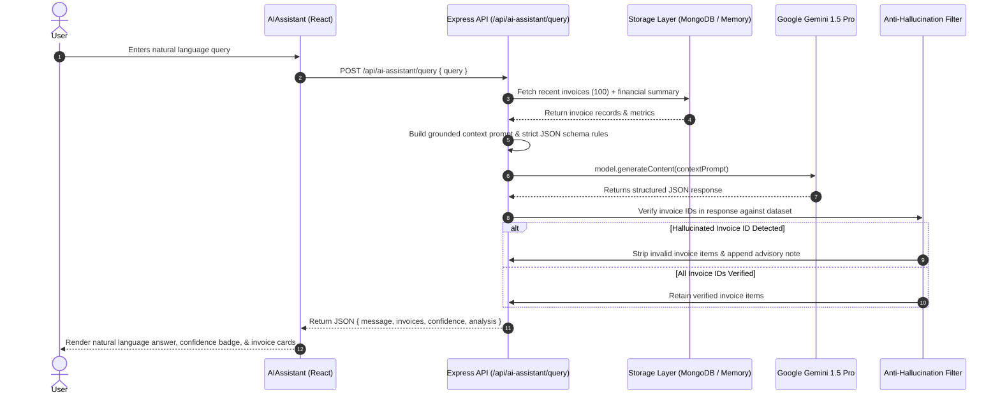
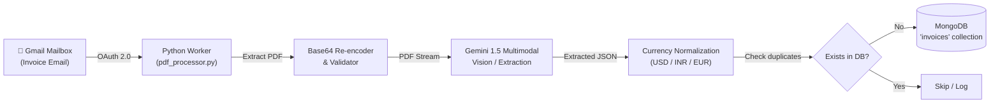
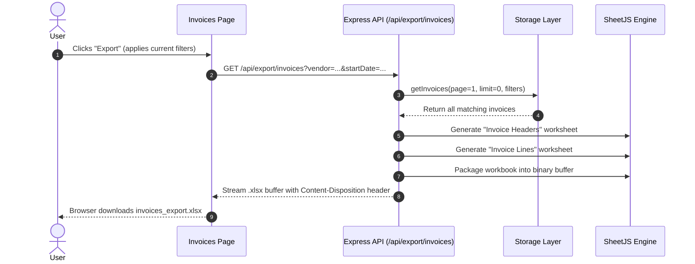
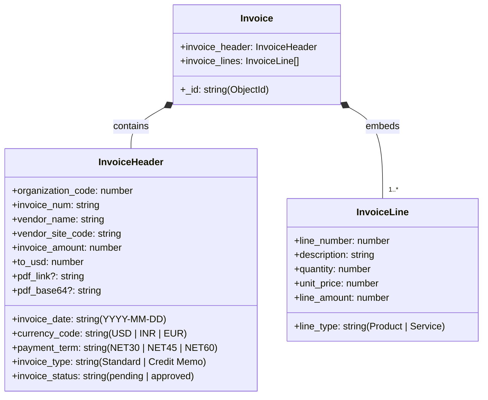

# AutomateInvoice


**AutomateInvoice** is a full-stack, AI-powered invoice management web application built to streamline how you browse, filter, edit, export, and analyze invoice data.

With seamless email integration, MongoDB document storage, and an intelligent Gemini-backed AI assistant, AutomateInvoice is your central hub for managing financials effortlessly.

---

## Features

- **Interactive Dashboard:** View summary metrics, trends, and charts for a bird's-eye view of your finances.
- **Advanced Filtering & Pagination:** Quickly find what you need with powerful search and multi-criteria filters.
- **Invoice Management:** View detailed invoice header information alongside line items, and edit details directly via an intuitive modal.
- **AI-Powered Assistant:** A built-in chat interface powered by Google's Gemini AI to answer questions about your invoice data instantly and accurately.
- **Automated PDF Processing:** Processes PDF attachments directly from emails via Gmail API and multimodal OCR.
- **Excel Export:** Export your filtered data views directly into `.xlsx` formats for external reporting.

---

## Tech Stack

### Frontend
- **Framework**: React with TypeScript and Vite
- **Styling**: Tailwind CSS & shadcn/ui components
- **State & Data Fetching**: TanStack Query (React Query)
- **Routing**: Wouter
- **Data Visualization**: Recharts

### Backend & Services
- **Server**: Node.js & Express (TypeScript)
- **Database**: MongoDB (via official Node Driver) with MemoryStorage fallback
- **AI Integration**: Google Generative AI (Gemini 1.5 Pro) API
- **Validation**: Zod (Shared contracts between client and server)
- **Export Engine**: SheetJS (`xlsx`) for multi-sheet spreadsheet generation

### Ingestion Pipeline
- **Runtime**: Python 3
- **Email Ingestion**: Google Gmail API (`googleapiclient`, OAuth 2.0)
- **Document OCR / AI**: Google Generative AI (Gemini Multimodal)
- **Database Driver**: PyMongo
- **Forex Conversion**: `forex-python` & static currency converters

---

## System Architecture

### High-Level System Architecture



---

### Component Breakdown

| Layer | Component | Technologies | Responsibilities |
| :--- | :--- | :--- | :--- |
| **Frontend** | Single Page Application | React 18, Vite, TypeScript | Interactive UI for managing, browsing, and inspecting invoices. |
| **Frontend** | State & Data Fetching | TanStack Query (React Query) | Server-state caching, automatic refetching, mutation invalidation. |
| **Frontend** | UI Components | shadcn/ui, Tailwind CSS, Lucide | Modern design system, accessible dialogs, toasts, responsive sidebar. |
| **Frontend** | Document Preview | Custom Base64 / IFrame Viewer | Renders invoice PDFs directly in-browser with download/new-tab capabilities. |
| **Backend** | API Gateway & Middleware | Express 4, Node.js, TypeScript | Request routing, logging, JSON middleware, error handling. |
| **Backend** | Contract Validation | Zod, `@shared/schema` | Type-safe schema validation across client and server boundaries. |
| **Backend** | Storage Abstraction | `IStorage` interface | Flexible layer toggling between `MongoStorage` and `MemoryStorage`. |
| **Backend** | Analytics & Aggregations | MongoDB Aggregation Pipelines | Computes total spend, monthly trends, and invoice type distributions. |
| **Backend** | Excel Generation | SheetJS (`xlsx`) | Converts multi-level invoice headers and lines into structured `.xlsx` workbooks. |
| **Backend** | AI Orchestrator | `@google/generative-ai` | Enforces prompt grounding, context hydration, and anti-hallucination guardrails. |
| **Ingestion** | PDF Processing Worker | Python 3, PyMongo, Gmail API | Reads email attachments, extracts metadata with Gemini, and seeds MongoDB. |

---

### Key Workflows & Data Flows

#### 1. AI Assistant Query & Anti-Hallucination Pipeline
The AI Assistant injects grounded context from MongoDB into Google Gemini and applies a deterministic validation filter to verify returned invoice references against database records before returning results to the client.



#### 2. Automated Email & PDF Ingestion Flow
Invoices received via email are processed asynchronously by the Python ingestion worker using Gemini's multimodal capabilities.



#### 3. Excel Export Workflow
When exporting filtered views, the server queries all matching invoices without pagination limits and constructs a two-sheet workbook:



---

### Data Model & Entity Relationship

Each invoice is stored as a cohesive document featuring an invoice header and an embedded array of line items. Total amounts and USD conversions are kept consistent with the sum of line items.



---

### Codebase Directory Structure

```
automateinvoice/
├── client/                     # Frontend React application
│   ├── index.html              # HTML entry point
│   └── src/
│       ├── App.tsx             # Root router, navigation, layout shell
│       ├── main.tsx            # React DOM bootstrap
│       ├── components/
│       │   ├── dashboard/      # Stat cards, monthly spending & invoice type charts
│       │   ├── filters/        # Date range & multi-criteria filter controls
│       │   ├── invoices/       # Invoice table, line items, edit modal, PDF viewer
│       │   ├── layout/         # App layout wrappers
│       │   └── ui/             # Reusable shadcn/ui component library
│       ├── hooks/              # Custom React hooks (e.g. use-toast)
│       ├── lib/                # Query client setup, formatters, utilities
│       └── pages/              # Primary views (Dashboard, Invoices, Details, AI Assistant)
├── server/                     # Backend Express server & Python worker
│   ├── index.ts                # Server startup, logging middleware, port binding (3002)
│   ├── routes.ts               # REST API endpoints, Excel export & Gemini AI integration
│   ├── storage.ts              # Storage abstraction (MongoStorage & MemoryStorage fallback)
│   ├── pdf_processor.py        # Python ingestion worker (Gmail & Gemini PDF parser)
│   └── vite.ts                 # Vite development middleware and static asset serving
├── shared/
│   └── schema.ts               # Shared TypeScript interfaces & Zod validation schemas
├── attached_assets/            # Demo PDF fixtures and mock data generation scripts
├── package.json                # Project dependencies and npm scripts
├── tsconfig.json               # TypeScript compiler configuration
├── tailwind.config.ts          # Tailwind CSS theme configuration
└── vite.config.ts              # Vite bundling configuration
```

---

## Getting Started

### Prerequisites
- Node.js (v18 or higher)
- npm (or yarn/pnpm)
- A MongoDB cluster/instance
- A Google Gemini API Key

### Installation

1. **Clone the repository**
   ```bash
   git clone https://github.com/gitpranaav/automateinvoice.git
   cd automateinvoice
   ```

2. **Install dependencies**
   ```bash
   npm install
   ```

3. **Configure Environment Variables**
   Create a `.env` file in the root directory using the provided template:
   ```bash
   cp .env.example .env
   ```
   *Fill in your `MONGO_URI` and `GEMINI_API_KEY` inside `.env`.*

4. **Run the Application**
   ```bash
   npm run dev
   ```
   *The client and server will start concurrently. The app will be available at `http://localhost:3002`.*

---

## Build & Production

To build the app for production and type-check:

```bash
npm run check
npm run build
npm run start
```

---

## API Endpoints Reference

| Method | Endpoint | Description |
| :--- | :--- | :--- |
| `GET` | `/api/invoices` | List invoices with filters and pagination |
| `GET` | `/api/invoices/:invoice_num` | Fetch a specific invoice's details |
| `PUT` | `/api/invoices/:invoice_num` | Update invoice header fields |
| `GET` | `/api/analytics/summary` | Fetch dashboard analytics and metrics |
| `GET` | `/api/vendors` | Fetch a list of all distinct vendors |
| `GET` | `/api/export/invoices` | Export filtered invoice data to Excel |
| `POST` | `/api/ai-assistant/query` | Query the AI assistant against invoice data |

---

> Built by Snacks(LeviathanExecutionUnit) in COEP INSPIRON 4.0 Hackathon March-2025.
